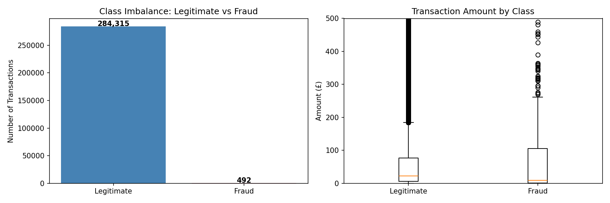
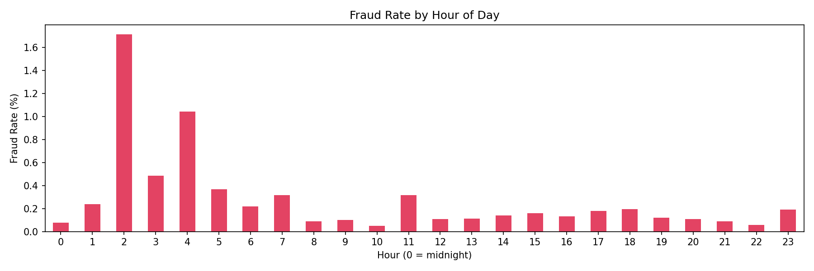
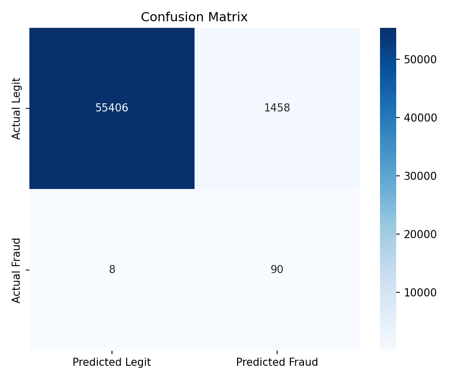
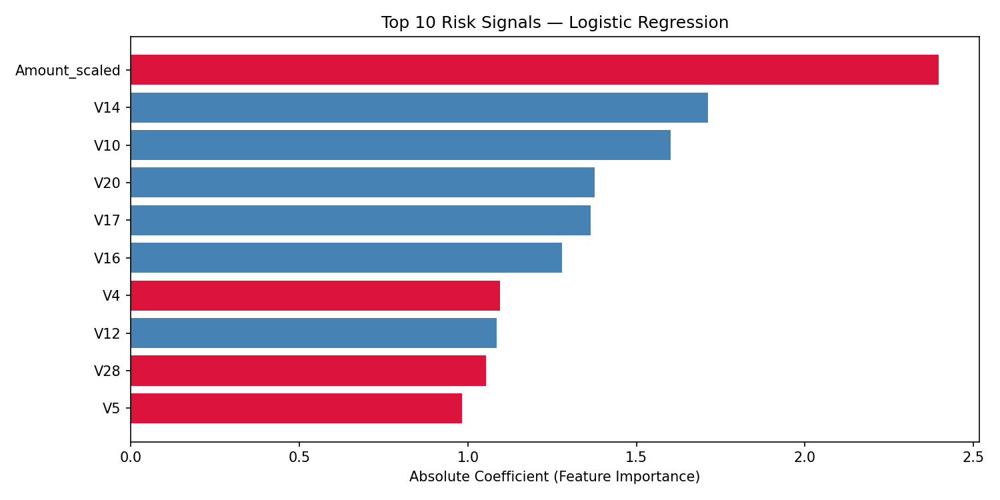

# Credit Card Fraud Pattern Analysis

   > Identifying behavioural fraud signals in 284,807 credit card transactions under extreme class imbalance (99.83% legitimate), recovering 92% of fraud cases as a triage filter for manual review.

Machine learning analysis of 284,807 credit card transactions to detect fraud patterns, addressing severe class imbalance using SMOTE and logistic regression.

## Results

Evaluated on a stratified held-out test set of 56,962 transactions containing 98 fraud cases. All random seeds are fixed, so `fraud_script.py` reproduces these figures exactly.

| Metric | Value |
|---|---|
| Fraud recall | 91.8% (90 of 98 caught) |
| Fraud precision | 5.8% (90 of 1,548 flagged) |
| F1 (fraud class) | 0.109 |
| PR-AUC | 0.725 |
| ROC-AUC | 0.970 |

| Confusion matrix | Predicted legitimate | Predicted fraud |
|---|---|---|
| **Actual legitimate** | 55,406 | 1,458 |
| **Actual fraud** | 8 | 90 |

- **Class imbalance**: 99.83% legitimate vs 0.17% fraud, handled with SMOTE applied to the training split only
- **Strongest coefficient**: transaction amount, ahead of the PCA components V14 and V10. Fraud rate varies by hour of day in the exploratory analysis, but `Time` ranks 20th of 30 in the model and is not a top predictor

## How to read these numbers

This is a triage filter, not an auto-block. It reduces 56,962 transactions to 1,548 for review while retaining 92% of the fraud, at roughly 16 false alarms per true positive. Whether that trade is worth making depends on the cost of a manual review against the cost of a missed fraud, which this dataset does not provide.

Recall is weighted over precision because the two errors are asymmetric: a missed fraud costs the full transaction value, a false positive costs a review. The decision threshold here is the scikit-learn default of 0.5 and was not tuned against a cost ratio.

Accuracy is not reported because it is uninformative at this base rate. A model predicting "legitimate" for every transaction scores 99.83%.

## Charts
| Class Imbalance | Fraud Rate by Hour |
|---|---|
|  |  |

| Confusion Matrix | Feature Importance |
|---|---|
|  |  |

## Approach
1. **Exploratory analysis** — visualised class imbalance and transaction patterns by hour and amount
2. **Feature engineering** — scaled `Amount` and `Time` using StandardScaler; extracted hour-of-day for the exploratory charts
3. **Stratified split** — 80/20, stratified on the class label, before any resampling
4. **SMOTE resampling** — synthetically oversampled fraud cases in the training split only, balancing it to 227,451 of each class
5. **Logistic regression** — trained on the resampled training data, evaluated on the untouched test split
6. **Feature importance** — ranked model coefficients to surface the primary behavioural risk signals

## Known limitations

- **Scaler leakage.** `StandardScaler` is fitted on the full `Amount` and `Time` columns before the train/test split, so test-set statistics influence the scaling. The effect is immaterial across two features and 284,807 rows, but the correct construction is an `imblearn` Pipeline fitted inside each fold.
- **Coefficients are not on a common scale.** `Amount` and `Time` are standardised, while `V1`–`V28` are raw PCA components with differing variances, so comparing coefficient magnitudes across them is only approximate. Permutation importance would give a fairer ranking.
- **Logistic regression is a readable baseline, not the best model.** Gradient boosting would likely improve PR-AUC and was not tested here.
- **The threshold is untuned.** Precision and recall trade off along the PR curve; choosing a point on it requires a cost ratio that this dataset does not supply.
- **Features are not interpretable.** V1–V28 are PCA components published for confidentiality, so the model cannot explain *why* a transaction looks fraudulent in business terms, only that it does.

## Tech Stack
- Python, Pandas, NumPy
- Scikit-learn (LogisticRegression, StandardScaler, train_test_split)
- Imbalanced-learn (SMOTE)
- Matplotlib, Seaborn

## Dataset
[Credit Card Fraud Detection](https://www.kaggle.com/datasets/mlg-ulb/creditcardfraud) — ULB Machine Learning Group via Kaggle. 284,807 transactions from September 2013, 492 of them fraudulent. Features V1–V28 are PCA components; `Time` and `Amount` are the only untransformed columns.

Download `creditcard.csv` and place it in the root directory before running.

## Run
```bash
pip install pandas numpy matplotlib seaborn scikit-learn imbalanced-learn
python fraud_script.py
```
